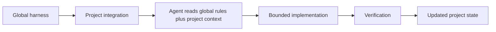

# AI Development Harness

Version 1.3.0

A centralized AI development harness for consistent, reliable agent
behavior across projects.

It sits above your application repositories and coding agents and
supplies shared rules, skills, workflows, safety guardrails,
documentation discipline, and verification. Agents reconstruct canonical
project context instead of re-deriving standards from a thin prompt.

This is not a prompt pack and not a drop-in `AGENTS.md` template. It is
an engineering harness used in production: global standards plus
project-specific context, wired into real repos through bootstrap.

Internal scripts and clone paths still use `ai-platform` /
`$AI_PLATFORM`. That is compatibility naming, not a second product.

Projects own business logic. This repository owns reusable knowledge.

## Why this exists

Project-specific AI instructions work for one repo and one operator.
They degrade as agent usage and project count grow:

- behavior drifts between projects
- the same engineering standards are re-explained in every thread
- rules are ignored or applied inconsistently
- agents assume versions and architecture instead of reading them
- unsafe git, dependency, and database actions slip through
- UI and code conventions diverge
- tasks expand past the request
- verification is skipped
- docs and implementation fall out of sync
- confidence drops as more work is delegated

A collection of prompts cannot enforce that. The harness does: shared
directives, project contracts, bounded tasks, and checks that are part
of done.

## What the harness provides

| Area | What you get |
| --- | --- |
| Global agent directives | Identity boundary, safety, Current-First / Framework-Native First, instruction priority (`00-platform`, `core/agent-core.md`) |
| Coding standards | Focused implementation, Tailwind composition, no opportunistic scope (`20-coding`) |
| Framework profiles | Laravel and Roots/Radicle/Sage rules that attach only when that stack is present. WordPress with Tailwind and `theme.json` follows `36-wordpress-theme` |
| UI / design | Product-specific design constraints; Hallmark for significant UI (`40-ui`) |
| Workflows | Bootstrap, adoption, documentation contracts (`50-workflows`) |
| Optional Deployer | Optional SSH/PHP deployment foundation; install does not deploy (`docs/contracts/features/deployer.md`) |
| Public submissions | Server-side spam and abuse protection when a project accepts public submissions (`docs/contracts/features/spam-and-abuse-protection.md`) |
| Project context | Working mode, status, ADRs, selective contract loading |
| Skills | Locked Hallmark skill, restored into projects |
| Verification | Doctor, copy/Tailwind guardrails, authorized browser QA |
| Safety | No commit/push/merge/dependency change without approval |
| Adoption / bootstrap | Link harness into new or existing apps without rewriting them |
| Maintenance | Update clone, re-bootstrap managed files, update skills |

Supported agents (capabilities are not identical): **Cursor** (reference),
**Grok Build**, **OpenAI Codex**, **Claude Code**, and **Hermes Agent**
(Nous Research). Matrix: [core/adapters/README.md](core/adapters/README.md).

You do not choose an agent during bootstrap. A project may use more than
one supported client.

## How it works



Shared `00`–`70` rules in a project are **symlinks** into this clone.
Project `docs/` and `90-*.mdc` stay local.

Full model, global vs project table, and a short before/after example:
[How the harness works](docs/how-it-works.md).

## Quick start

Pick a **stable** clone path (bootstrap writes absolute symlink
targets). Then:

```bash
git clone https://github.com/ConlinJoe/ai-platform.git ~/src/ai-platform
AI_PLATFORM="$HOME/src/ai-platform"
cd "$AI_PLATFORM"
chmod +x scripts/*.sh scripts/lib/*.sh
./scripts/doctor.sh
```

`~/src/ai-platform` is an example, not a required location.

Bootstrap a project and verify:

```bash
"$AI_PLATFORM/scripts/bootstrap-project.sh" /path/to/your-project
ls -l /path/to/your-project/.cursor/rules
"$AI_PLATFORM/scripts/doctor.sh" /path/to/your-project
```

Interactive bootstrap may ask `Install Deployer deployment stack? [y/N]`
(default N). Pass `--with-deployer` or `--without-deployer` to skip the
prompt. Installing Deployer does not deploy anything and does not
authorize deployment. Add it later with
`"$AI_PLATFORM/scripts/install-deployer.sh" /path/to/your-project`.
Canonical reference: [Deployer capability](docs/contracts/features/deployer.md).

Linked `00`–`70` rules should point into `$AI_PLATFORM/.cursor/rules/`.
That is the harness install check. On Laravel apps, project doctor also
diagnoses Boost and may exit non-zero until Boost is installed. That is
a profile gap, not a failed rule link.

Complete prerequisites, optional agents/MCP, skill restore, and
greenfield vs existing next steps:
**[Getting started](docs/getting-started.md)**.

## Documentation

| Topic | Page |
| --- | --- |
| Installation / getting started | [Getting started](docs/getting-started.md) |
| How the harness works | [How the harness works](docs/how-it-works.md) |
| Rules (canonical) | [.cursor/rules/](.cursor/rules/) and [core/agent-core.md](core/agent-core.md) |
| Skills | [How the harness works](docs/how-it-works.md#skills) · lockfile `skills-lock.json` |
| Workflows | [.cursor/rules/50-workflows.mdc](.cursor/rules/50-workflows.mdc) |
| Project adoption | [Adopting projects](docs/adopting-projects.md) · [adoption prompt](core/prompts/project-adoption.md) |
| Roots upgrades | [Roots upgrade procedure](docs/contracts/features/roots-upgrade.md) · [runbook](core/prompts/roots-upgrade.md) |
| Project context and documentation | [Documentation philosophy](docs/documentation-philosophy.md) · [contract registry](docs/README.md) |
| UI standards | [.cursor/rules/40-ui.mdc](.cursor/rules/40-ui.mdc) |
| Safety guardrails | [How the harness works](docs/how-it-works.md#verification-and-safety) |
| Optional Deployer | [Deployer capability](docs/contracts/features/deployer.md) |
| Verification / QA | [Browser QA](docs/contracts/features/browser-qa.md) · `scripts/doctor.sh` · `scripts/check-guardrails.sh` |
| Updating / maintaining | [Maintaining the harness](docs/maintaining.md) |
| Troubleshooting | [Maintaining the harness](docs/maintaining.md#troubleshooting) |
| LLM support assistant | [LLM support prompt](docs/llm-support-prompt.md) |
| Architecture / ADRs | [docs/contracts/adrs/](docs/contracts/adrs/) |
| Agent adapters | [core/adapters/README.md](core/adapters/README.md) |
| MCP ownership | [mcp/README.md](mcp/README.md) |
| ChatGPT export | [ChatGPT Projects](docs/chatgpt-projects.md) |
| Work items / PRs | [Work-item lifecycle](docs/contracts/features/work-item-lifecycle.md) |
| Fresh-thread resume prompt | [core/prompts/resume.md](core/prompts/resume.md) |
| Changelog | [CHANGELOG.md](CHANGELOG.md) |

`docs/README.md` is the **contract registry** for this repository (agent
loading). The table above is the human index.

## Help from your preferred LLM

Paste [docs/llm-support-prompt.md](docs/llm-support-prompt.md) into
ChatGPT, Claude, Gemini, Grok, or another capable model and give it
access to this clone. The prompt teaches the model how to inspect the
harness. It does not embed a stale copy of the rules.

## Repository structure

```text
.cursor/rules/     canonical Cursor rules (symlinked into projects)
core/agent-core.md portable always-on core (AGENTS.md / CLAUDE.md)
core/adapters/     per-agent setup and capability matrix
core/prompts/      adoption, resume, and Roots upgrade prompts
.agents/skills/    locked skills (Impeccable, Hallmark)
scripts/           bootstrap, doctor, Deployer installer, update-skills, export, guardrails
templates/         docs copied into new projects; optional Deployer recipes
docs/              this harness's contracts and public guides
mcp/               MCP ownership notes (not an installer)
```

## Design principles

- Canonical project context, reconstructed fresh each thread
- Global standards plus project-specific contracts
- Rules over repeated prompting
- Bounded tasks and capture-don't-expand
- Verification over trust
- Current-First and Framework-Native First
- Safe defaults (no commit, push, dependency change, or deploy unless asked)
- Documentation and ADRs as part of the system
- Incremental adoption without silent migrations

## License

MIT. See [LICENSE](LICENSE).
