# Documentation Index

This file is the dependency graph and contract registry for the
AI Development Harness repository (`ai-platform`).

Public landing page: [`../README.md`](../README.md).
First-time install: [`getting-started.md`](getting-started.md).

## Overview

The AI Platform repository documents its own standards under `docs/`.
Public guides (getting started, how it works, adoption, maintenance, LLM
support) sit alongside internal contracts. Individual development
projects maintain their own `docs/` directory using the same contract
model and templates from `templates/docs/`.

## Contract Registry

| Contract | Type | Status | Source of Truth For |
| --- | --- | --- | --- |
| `00-project-context.md` | foundational | active | Harness summary for ChatGPT and agents |
| `working-mode.md` | continuation | active | Current working mode and agent continuation |
| `99-project-status.md` | status | active | Implementation status and validation |
| `getting-started.md` | foundational | active | First-time clone, doctor, bootstrap, verification |
| `how-it-works.md` | foundational | active | Conceptual model; global vs project files |
| `adopting-projects.md` | foundational | active | New vs existing adoption (human overview) |
| `maintaining.md` | foundational | active | Updates, skills, doctor, troubleshooting, removal |
| `llm-support-prompt.md` | foundational | active | Model-neutral LLM support seed |
| `documentation-philosophy.md` | foundational | active | Documentation contract standard |
| `chatgpt-projects.md` | foundational | active | ChatGPT Projects export workflow |
| `contracts/adrs/0001-two-layer-browser-qa.md` | adr | accepted | Decision to use Mode A/B browser QA |
| `contracts/adrs/0002-laravel-boost-ownership.md` | adr | accepted | Decision that Boost is project-native |
| `contracts/adrs/0003-work-item-lifecycle.md` | adr | accepted | Decision to use a provider-neutral work-item lifecycle with GitHub as reference |
| `contracts/adrs/0004-design-stack-and-ui-visual-verification.md` | adr | accepted | Decision to route significant product UI to Impeccable, expressive art direction to Hallmark, and authorize bounded Mode B visual verification |
| `contracts/adrs/0005-agent-continuation-and-concise-reporting.md` | adr | accepted | Decision to store agent continuation in working-mode.md and default to concise completion reporting |
| `contracts/adrs/0006-instruction-precedence-and-mechanical-guardrails.md` | adr | accepted | Decision that project/platform rules outrank secondary guidance and that em-dash/Tailwind arbitrary values are mechanically checked |
| `contracts/adrs/0007-optional-deployer-capability.md` | adr | accepted | Decision that Deployer is the standardized optional deployment foundation |
| `contracts/adrs/0008-substantial-redesign-comp-approval.md` | adr | accepted | Decision that a substantial UI redesign requires an approved project-local review comp before application UI changes |
| `contracts/adrs/0009-roots-upgrade-procedure.md` | adr | accepted | Decision to keep Roots upgrades in one procedure without changing an existing project's generation |
| `contracts/features/browser-qa.md` | feature | active | Browser QA policy, invocation, capability-aware visual verification, Playwright vs interactive distinction, applicability, isolation |
| `contracts/features/copy-and-tailwind-guardrails.md` | feature | active | Mechanical em-dash and Tailwind arbitrary-value check, exceptions, DONE gating |
| `contracts/features/deployer.md` | feature | active | Optional Deployer capability, installer, server configuration, deploy authorization |
| `contracts/features/laravel-boost.md` | feature | active | Boost capability, detection, bootstrap/doctor |
| `contracts/features/work-item-lifecycle.md` | feature | active | Capture-don't-expand, Issues/PRs, approval boundaries, optional gh |
| `contracts/features/spam-and-abuse-protection.md` | feature | active | Public submission spam and abuse protection, not-applicable recording, adoption inventory, safe rollout |
| `contracts/features/roots-upgrade.md` | feature | active | Roots upgrade procedure for Bedrock, Sage, Radicle, Acorn, and Bud |

## Dependency Graph

```mermaid
flowchart TD
  context[00-project-context.md]
  workingMode[working-mode.md]
  status[99-project-status.md]
  gettingStarted[getting-started.md]
  howItWorks[how-it-works.md]
  adopting[adopting-projects.md]
  maintaining[maintaining.md]
  llmSupport[llm-support-prompt.md]
  philosophy[documentation-philosophy.md]
  chatgpt[chatgpt-projects.md]
  browserAdr[contracts/adrs/0001-two-layer-browser-qa.md]
  boostAdr[contracts/adrs/0002-laravel-boost-ownership.md]
  workAdr[contracts/adrs/0003-work-item-lifecycle.md]
  designAdr[contracts/adrs/0004-design-stack-and-ui-visual-verification.md]
  continuationAdr[contracts/adrs/0005-agent-continuation-and-concise-reporting.md]
  guardrailAdr[contracts/adrs/0006-instruction-precedence-and-mechanical-guardrails.md]
  deployerAdr[contracts/adrs/0007-optional-deployer-capability.md]
  compAdr[contracts/adrs/0008-substantial-redesign-comp-approval.md]
  rootsUpgradeAdr[contracts/adrs/0009-roots-upgrade-procedure.md]
  browserQa[contracts/features/browser-qa.md]
  boost[contracts/features/laravel-boost.md]
  workItems[contracts/features/work-item-lifecycle.md]
  guardrails[contracts/features/copy-and-tailwind-guardrails.md]
  deployer[contracts/features/deployer.md]
  spam[contracts/features/spam-and-abuse-protection.md]
  rootsUpgrade[contracts/features/roots-upgrade.md]

  chatgpt --> philosophy
  chatgpt --> context
  philosophy --> context
  workingMode --> context
  workingMode --> status
  status --> context
  gettingStarted --> howItWorks
  gettingStarted --> context
  howItWorks --> context
  adopting --> gettingStarted
  adopting --> howItWorks
  maintaining --> gettingStarted
  maintaining --> adopting
  llmSupport --> gettingStarted
  llmSupport --> howItWorks
  continuationAdr --> philosophy
  browserAdr --> browserQa
  boostAdr --> boost
  workAdr --> workItems
  designAdr --> browserQa
  guardrailAdr --> guardrails
  guardrailAdr --> designAdr
  deployerAdr --> deployer
  compAdr --> designAdr
  rootsUpgradeAdr --> rootsUpgrade
  compAdr --> browserQa
  browserQa --> browserAdr
  boost --> boostAdr
  workItems --> workAdr
  guardrails --> guardrailAdr
  deployer --> deployerAdr
  rootsUpgrade --> rootsUpgradeAdr
```



## Loading Guide

| Task type | Start with |
| --- | --- |
| Public overview | `../README.md` |
| ChatGPT / platform overview | `00-project-context.md` |
| Fresh agent / resume | `working-mode.md`, `../core/prompts/resume.md` |
| First-time clone / onboarding | `getting-started.md` |
| How the harness works | `how-it-works.md` |
| New or existing project adoption | `adopting-projects.md`, `../core/prompts/project-adoption.md` |
| Updates / troubleshooting / removal | `maintaining.md` |
| LLM support seed | `llm-support-prompt.md` |
| Documentation standard | `documentation-philosophy.md` |
| ChatGPT export setup | `chatgpt-projects.md` |
| UI / design preferences | `.cursor/rules/40-ui.mdc`, `contracts/adrs/0004-design-stack-and-ui-visual-verification.md` |
| Substantial UI redesign | `.cursor/rules/40-ui.mdc`, `../core/prompts/ui-comp-approval.md`, `contracts/adrs/0008-substantial-redesign-comp-approval.md` |
| Copy / Tailwind guardrails | `contracts/features/copy-and-tailwind-guardrails.md`, ADR 0006 |
| Multi-agent adapters | `core/adapters/README.md` |
| Bootstrap behavior (agent) | `scripts/bootstrap-project.sh`, `.cursor/rules/50-workflows.mdc` |
| Optional Deployer | `contracts/features/deployer.md`, ADR 0007 |
| Browser QA / Playwright | `contracts/features/browser-qa.md` |
| Laravel Boost / MCP | `contracts/features/laravel-boost.md`, `mcp/README.md` |
| Issues, PRs, discovered work | `contracts/features/work-item-lifecycle.md` |
| Public submission protection | `contracts/features/spam-and-abuse-protection.md` |
| Laravel web app profile | `core/project-profiles/laravel-webapp.md` |
| Roots/Radicle/Sage profile | `core/project-profiles/roots-radicle.md` |
| WordPress, Tailwind, and theme.json | `.cursor/rules/36-wordpress-theme.mdc` |
| Roots upgrade / Roots security assessment | `contracts/features/roots-upgrade.md`, `../core/prompts/roots-upgrade.md`, `contracts/adrs/0009-roots-upgrade-procedure.md` |

## ChatGPT Export

```bash
scripts/export-chatgpt-context.sh
```

Produces `.build/chatgpt-context.zip` with documentation, Cursor rules, agent
skills, `AGENTS.md` / `CLAUDE.md`, and project AI metadata.
