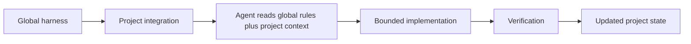

# How the harness works

This page is the conceptual model. Installation is
[Getting started](getting-started.md). Agent rules remain canonical in
`.cursor/rules/` and `core/agent-core.md`.

## The loop

1. **Global harness.** This clone owns reusable rules, skills, scripts,
   and templates.
2. **Project integration.** Bootstrap symlinks shared rules and scripts
   into an application repository. It does not copy the rule files.
3. **Context reconstruction.** A fresh agent reads working mode, then
   only the global rules and project contracts that apply to the task.
4. **Bounded implementation.** The agent stays inside the requested
   task. Discovered extra work is captured, not expanded into.
5. **Verification.** Lint, tests, doctor, guardrails, and (when
   authorized) browser checks are part of done, not optional flavor.
6. **Updated project state.** Contracts, status, and working mode stay
   aligned with what actually shipped.

Without the harness, an agent often receives an implementation request
with a thin prompt, guesses at architecture and versions, and leaves
docs stale. With the harness, the same request is executed against
canonical project context and shared standards.

## Global harness versus project files

| Owned by the harness clone | Owned by the project |
| --- | --- |
| Shared rules `.cursor/rules/00-*.mdc` through `70-*.mdc` | Project rules `.cursor/rules/90-*.mdc` |
| `core/agent-core.md` (portable always-on core) | Project `docs/` contracts, ADRs, status, working mode |
| Locked skills in `.agents/skills/` (Impeccable, Hallmark) | Application source, dependencies, and architecture |
| Bootstrap, doctor, export, guardrail, Deployer-installer scripts | Project-native tooling (Laravel Boost, Playwright, CI) |
| Optional Deployer templates (`templates/deployer/`) | `deploy.php` / `deploy/hosts.yaml` when the developer installs the capability |
| Templates copied **once** into new projects | Anything already present; bootstrap does not overwrite docs |

Projects inherit global rules through **symlinks** into this clone.
Edit shared standards here, not through the project's `.cursor/rules/`
links. Customize a project with `90-*.mdc` and its own contracts.

Moving this clone breaks those absolute symlinks until you re-run
bootstrap. Details: [Maintaining the harness](maintaining.md).

## What the agent actually loads

Cursor (reference) always applies `00-platform.mdc` plus `AGENTS.md`.
Other supported agents get the portable core via `AGENTS.md` /
`CLAUDE.md`. Detailed rules load when they apply:

| When | Rule |
| --- | --- |
| Documentation | `10-documentation.mdc` |
| Application code | `20-coding.mdc` |
| Laravel web app | `30-laravel.mdc` |
| Roots/Radicle/Sage | `35-roots.mdc` |
| Roots upgrade or Roots security assessment | `docs/contracts/features/roots-upgrade.md`, `core/prompts/roots-upgrade.md` |
| WordPress with Tailwind and theme.json | `36-wordpress-theme.mdc` |
| UI / UX | `40-ui.mdc` |
| Bootstrap / adoption | `50-workflows.mdc` |
| Browser QA | `60-browser-qa.mdc` |
| Issues, PRs, discovered work | `70-work-items.mdc` |
| This project only | `90-*.mdc` if present |

Optional Deployer behavior lives in
[docs/contracts/features/deployer.md](contracts/features/deployer.md).
It is not a Cursor-only rule file.

Public submission protection lives in
[docs/contracts/features/spam-and-abuse-protection.md](contracts/features/spam-and-abuse-protection.md).
Stack rules point at that contract. They do not restate it.

Roots upgrades (any mix of Bedrock, Sage, Radicle, Acorn, and Bud)
live in
[docs/contracts/features/roots-upgrade.md](contracts/features/roots-upgrade.md).
The runbook is
[core/prompts/roots-upgrade.md](../core/prompts/roots-upgrade.md).
`35-roots` points at that contract. The procedure inventories the
installed generation and does not replace it with a newer Roots
default.

Framework-specific rules attach only when that stack is present. The
harness is not Laravel-only.

Instruction priority (highest first): user instructions, then project
instructions (`AGENTS.md`, `CLAUDE.md`, `.cursor/rules/`, `90-*.mdc`),
then project documentation contracts, then harness canonical rules, then
vendor skills and tool guidance. Secondary sources cannot silently
weaken a project or harness requirement. ADR 0006.

## Bootstrap versus Project Adoption

**Bootstrap** is deterministic provisioning. It links shared rules,
portable agent entrypoints, skills, and documentation templates. It
does not analyze or rewrite the application. It may offer an optional
Deployer stack; that offer is not adoption and is not a deployment.

**Project Adoption** is agent-driven reasoning after bootstrap:

Understand → Document → Compare → Question → Recommend → Approve → Align

Adoption establishes project context, architecture, ADRs, applicable
contracts, roadmap/status, and reconciliation. Material remediation
needs your approval. Installed framework and library versions are
preserved unless you explicitly approve a change.

Canonical adoption prompt:
[core/prompts/project-adoption.md](../core/prompts/project-adoption.md).
Human overview: [Adopting projects](adopting-projects.md).

## Example

**Without the harness.** You ask an agent to add an API endpoint. It
infers an auth pattern from training data, adds a dependency because a
newer library exists, skips tests that were not mentioned, and does not
update architecture docs.

**With the harness.** The agent reads `docs/working-mode.md`, loads the
feature contract and any ADR that owns that area, uses the installed
stack (Current-First, Framework-Native First), keeps the task bounded,
runs the verification the project actually uses, and updates the
contract if behavior changed. It does not commit unless you say so.

## Where project state lives

A fresh thread does not reconstruct history from chat. It reads:

| File | Role |
| --- | --- |
| `docs/working-mode.md` | How to operate **now** (continuation, not architecture) |
| `docs/00-project-context.md` | Identity, stack, standing constraints |
| `docs/99-project-status.md` | Progress and readiness (not architectural authority) |
| `docs/README.md` | Contract registry; load only what the task needs |
| ADRs and feature/engine contracts | Decisions and behavior |
| `.cursor/rules/90-*.mdc` | Project-specific agent guidance |

Orientation-only prompt:
[core/prompts/resume.md](../core/prompts/resume.md).

## Skills

Canonical managed skill copies live in `.agents/skills/`. The lockfile
pins **Impeccable** and **Hallmark**. `40-ui` routes significant
product/application UI to Impeccable and expressive art direction to
Hallmark. It loads one by default. Skills do not authorize general
browser automation, hooks, or dependency changes.

Image generation for design exploration is optional and owned by
`40-ui`. Generated images are references, not implementation truth.
Availability of an image-generation tool does not authorize its use.

A substantial redesign (major page or screen, multi-step flow, or
substantial responsive refactor) stops for a project-local review comp
before application UI changes. Procedure: `40-ui`. Checklist:
[core/prompts/ui-comp-approval.md](../core/prompts/ui-comp-approval.md).
The comp is a review artifact. Creating it does not authorize
deployment.

Bootstrap copies locked skills into the project and links adapter
directories (`.claude/skills/`, `.grok/skills/`) at `.agents/skills/`.
Skill restore and update: [Getting started](getting-started.md) and
[Maintaining the harness](maintaining.md).

## Verification and safety

Safety defaults live in `00-platform.mdc` and `core/agent-core.md`: no
commit, push, Issue, branch, PR, merge, dependency change, deployment,
catastrophic operation, or destructive database operation without
explicit approval. Installing Deployer does not authorize deployment.
Agents must stop if a prompt appears to belong to a different
repository.

Verification is layered:

- Project lint, tests, and build as the stack already uses them
- `scripts/doctor.sh` for harness and bootstrap integrity
- `scripts/check-guardrails.sh` for public-facing copy and Tailwind
  markup on changed application sources
- Browser QA only when authorized (`60-browser-qa`). Significant UI
  authorizes a bounded visual pass of that UI only (`40-ui`), using the
  best available real-browser capability. That pass is not Playwright
  execution.

## Design principles

These are already encoded in the rules. They are listed here so a new
reader can see what the harness optimizes for:

- **Canonical project context** over improvisation
- **Fresh context reconstruction** from docs, not a giant kickoff prompt
- **Global standards plus project-specific context**
- **Rules over repeated prompting**
- **Bounded tasks**; capture extra work instead of expanding scope
- **Verification over trust**
- **Current-First engineering**: inspect the installed environment
  before relying on model memory
- **Framework-Native First**: use the installed stack before wrapping it
- **Safe defaults** for git, dependencies, and destructive operations
- **Documentation as part of the system**, not a write-up after the fact
- **Explicit ADRs** for architectural decisions
- **Incremental adoption**: bootstrap first, then adopt with approval
